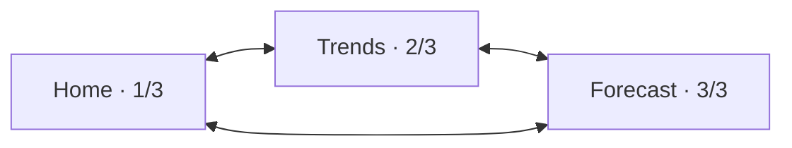

# Swipe navigation, trends, and forecast

Status: implemented interface and follow-up requirements, October 21, 2026
(local firmware v0.7.1). [Firmware scope](firmware/README.md) includes three-page navigation,
recorded/live data paths, minute history/checkpoints, day/night and hourly
NWS clients and alert details/themes. Consult [validation](firmware/VALIDATION.md)
for actual bench results. Live Atlas RF, NWS and owner-observed APRS.fi/WU/
Weathercloud ingestion are confirmed; extended outage/load and soak acceptance
remain open. The PC reference logger stays stopped. SD is optional.

Owner update, October 20: horizontal navigation wraps at both ends. A forward
swipe from Forecast returns to Home; a backward swipe from Home opens Forecast.

Home measurement details are implemented: tap outdoor/wind or a humidity,
rain or pressure tile. The 44-pixel header returns Home; the NWS strip opens
alert text and returns to the measurement detail afterward. Outdoor/wind/
humidity details support a horizontal swipe into their selected trend.
Rain details retain rolling hour/24-hour totals beside local-midnight Today.
The Home tile and portal overview use **RAIN TODAY** at the owner's latest
request. Pressure details identify nearby NWS source/type/age; missing or expired data
remains unavailable. NWS pressure does not become local station telemetry.

## Inactivity and display power — v0.6.0

Trends and Forecast return to Home after 60 seconds without touch. Touch or
scrolling restarts that timer; RF/network updates do not. Setup, measurement
and alert details are excluded. A separate persistent display setting keeps
the screen on, dims it or turns its backlight off after a selected interval.
The first touch wakes without navigating. All receiver/storage/network work
continues while dimmed or dark.

Forecast periods now show the project's condition icons. Night symbols use an
phase estimate for the forecast-period midpoint behind cloud, fog, precipitation
or wind artwork; the main Home moon
uses current phase data. The NWS label sits above the Home icon, away from the
local temperature graph. Settings access after initial setup shows the current
URL/admin guidance, with custom passwords hidden and deliberate Wi-Fi recovery.

## Three primary pages

| Page | Purpose | Main content |
| --- | --- | --- |
| Home · 1/3 | Conditions at the station now | Existing [home screen](HOME_SCREEN.md), including current wind and `Gust 5m`, temperature, humidity, rain, attributed NWS pressure when available, and klux/UV. |
| Trends · 2/3 | What happened over the last 24 hours | One selected measurement chart at a time, time axis, units, range summary, and visible gaps. |
| Forecast · 3/3 | What is expected at the configured location | NWS day/night outlook, upcoming hourly conditions, rain probability, wind, and forecast issue/check times. |



Home remains the startup page. Swipe left for the next page and right for the
previous page; wrap at both ends of the list. Preserve the compact v2 study
status header and indicate page position with subtle dots. The owner rejected
the initial prominent page banner on October 20; do not restore permanent
header navigation arrows. Keep the
chosen page until navigation or the 60-second idle return changes it. Alert
details and setup retain their separate dismissal behavior.

Recognize horizontal gestures in the content area, with movement thresholds
validated on the actual touch controller. Lock a gesture to its dominant axis:
vertical movement scrolls a list/detail, horizontal movement navigates. Once
a drag is recognized, cancel the tap target beneath it. The alert strip is
a dedicated tap target and does not initiate page swipes.

Detail pages keep a large Back control and return to their originating page,
selected metric, and scroll position. Alert details retain the behavior in [HOME_SCREEN.md](HOME_SCREEN.md).
Dismissal returns to the previous page without clearing the alert. Sound is
removed from this hardware version.

## Shared layout

Retain the 320×240 landscape baseline, with header y=0–43, content y=44–183,
and persistent alert strip y=184–239 on every primary page. Prominent header page arrows
were removed after the October 20 review; use the study's compact status
header and page dots instead. The RF/APRS connection-details targets and Wi-Fi setup target must not
interfere with horizontal navigation. Fit title, page position,
clock, and compact connection indicators after checking the actual panel.

Orange/red full-screen alert themes and the alert strip apply on all pages.
Opening Trends or Forecast cannot hide an active warning or imply an all-clear
when its check failed. Navigation/rendering must not pause RF reception,
history updates, serial output, uploads, or alert processing.

## Trends: rolling 24 hours

Current firmware offers temperature, wind peak, light, humidity and hourly rain and observed cumulative rain; tap the
chart to cycle metrics. Pressure charts, min/max envelopes and additional
chart controls below are follow-up requirements, not implemented controls.

Default to the trailing 24 hours, ending at now, with temperature selected.
Provide a metric selector with large previous/next controls, leaving the rest
of the content area for one readable chart. Offer temperature, humidity,
wind, rainfall, attributed NWS pressure when available, and klux/UV. Tap a chart for details.
Additional durations can follow later; the first implementation needs 24 hours.

- Store UTC and label local time and units. Twenty-four hours means the
  preceding 86,400 seconds, not the current calendar day. Disambiguate repeated
  local hours at daylight-saving changes.
- Build one-minute buckets from deduplicated bound-station observations, with
  per-field valid counts, coverage, and min/max/mean where meaningful. Another
  field's update cannot fill or freshen a bucket.
- Scalar plots may use a mean line with a min/max envelope. Preserve wind
  sample maxima during downsampling so brief reported peaks remain visible;
  label bucket extrema separately from the live `Gust 5m` statistic defined in
  [DESIGN.md](DESIGN.md#displayed-five-minute-wind-gust). Avoid arithmetic
  averaging of compass degrees if direction is later plotted.
- Rain bars represent counter-derived rainfall per interval. Handle resets
  and rollover; unresolved intervals remain gaps. Repeated absolute counter
  values are not new rain.
- Show missing/stale intervals as gaps. Do not extend cached readings into
  later buckets. Measured zero lux at night and calm wind remain valid zeros.
- Startup and outages show available data with `Collecting history` and
  coverage; leave the unavailable portion empty. Invalid time shows
  `Time unknown` until readings can be placed on a trustworthy time axis.
- Keep timestamped summaries in bounded RAM/PSRAM and checkpoint compact
  history to a bounded internal-flash partition so trends can recover after
  restart. Validate space, schema, write frequency, and power-loss recovery.
  Show any uncheckpointed interval as a recovery gap. SD and a raw packet
  archive are optional; absence of a card is normal operation.

Bound the 1,440 one-minute buckets, retained fields, checkpoint reads/writes, plotted points,
and rendering work. Downsample to plot width while preserving extrema.
Benchmark RAM/PSRAM and shared SPI use on the exact hardware profile rather
than loading a day of raw packets into memory.

## Forecast: local NWS outlook

On the display, one daily/hourly period is shown at a time: tap the mode
label to switch products, tap the body for the next period and drag vertically
to scroll its description. The browser lists the retained periods in cards.
The Home graphic requires current hourly data less than two hours old.

NWS is the implemented forecast provider and also supplies alerts.
The [official API documentation](https://www.weather.gov/documentation/services-web-api)
provides coordinate lookup and linked day/night and hourly products. Reuse
station coordinates entered during setup; show `Set location` until supplied.
Do not infer location from this PC or its timezone.

```text
GET https://api.weather.gov/points/{latitude},{longitude}
Accept: application/geo+json
User-Agent: CYDWeatherLink/0.1 (project contact URL or email)
```

Follow the returned `properties.forecast` and `properties.forecastHourly` URLs.
The first supplies day/night periods for seven days; the second supplies hourly
periods. Cache the coordinate-to-grid mapping, periodically revalidate it, and
refresh on location changes or mapping failures. Use TLS and an identifying
User-Agent. Unsupported locations show `Forecast unavailable for this location`;
another provider can be a later configuration choice.

The main page lists upcoming day/night periods: name, temperature/units, short
conditions, wind, and precipitation probability when available. Use large
vertically scrolling rows; tap for detailed text. An `Hourly` view shows the
next 24 hours. Label `NWS forecast`, location, issue time, and last successful
check. Predictions keep their own source labels and do not replace observed
station readings or inferred sky conditions on Home. Missing values show `—`.

Fetch in the background at startup, after reconnect, and on a normal
30-minute schedule with jitter, honoring cache/retry headers. Swiping pages
does not trigger repeated requests. Refresh products independently and retain
their separate issue/check times. Bound text, parsing, and retained periods:
at most seven days of day/night periods and the next 24 hourly periods.
Validate the API's current schema and units, including null/changed formats.

Persist a compact last-good forecast in a bounded internal-flash cache,
keeping network data out of the decoded-packet stream. Offline, retain valid
periods with `Offline · cached` and check age. The original design proposed staleness at 90 minutes
since successful validation of that product; failed requests cannot refresh
it. Provider issue time is distinct and can precede a successful check by hours.
Remove expired periods as time passes. Show unavailable with no usable cache;
location changes invalidate old forecasts, and invalid time prevents claiming
cached periods are current. Forecast failures cannot clear alerts or affect
local measurement freshness.

Use bounded network scheduling alongside uploaders, prioritizing alert checks
over forecasts. Each product reports its own health. Local readings and trends
continue without internet or an additional PC/gateway.

## Acceptance checks

- Test swipe/tap discrimination, noisy touch, end pages, vertical scrolling,
  page controls, detail returns, and long labels on the actual panel. Match
  alert themes/strip across every page.
- While swiping/plotting, verify history updates and serial output continue and
  compare RF reception with the SDR reference.
- Replay history with repeats, sparse fields, wind peaks, rain resets/rollover,
  zero lux, restarts, absent optional SD, checkpoint failures, invalid time, and daylight-saving changes.
  Verify coverage and extrema survive downsampling.
- Test forecast nulls, partial/malformed/oversized responses, changed grids,
  unsupported/changed locations, cache restore, old issue timestamps,
  endpoint-specific failures, rate limiting, and extended internet loss.
- Confirm expired periods disappear, cached data is labeled, alert priority
  remains visible, and TLS/JSON/chart memory stays bounded with all tasks active.

## Local browser overview

The protected phone overview follows At your station → 24-hour Trends → local
forecast/alerts → recording and setup. It mirrors Home readings and provenance
and keeps detailed trend gaps visible. Only the small Home-equivalent
temperature sparkline connects across missed minutes. New devices open setup
first; configured devices open Overview. See [firmware/WEB_DASHBOARD.md](firmware/WEB_DASHBOARD.md)
for data, paging, refresh and validation behavior.
